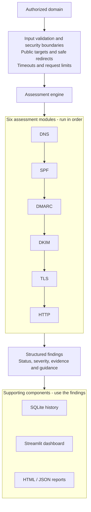
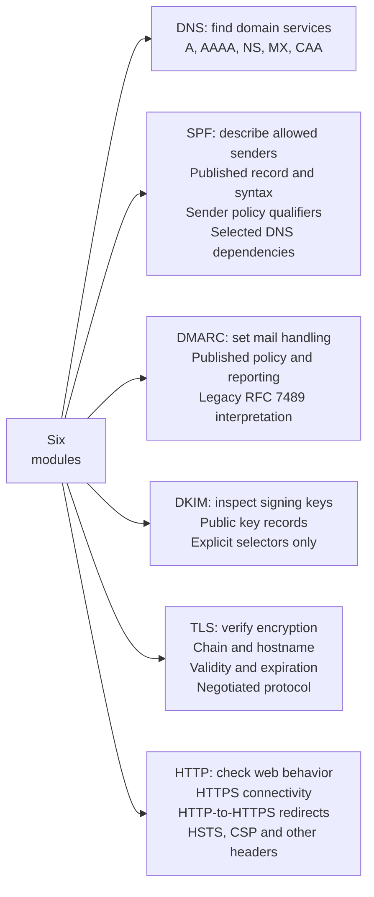
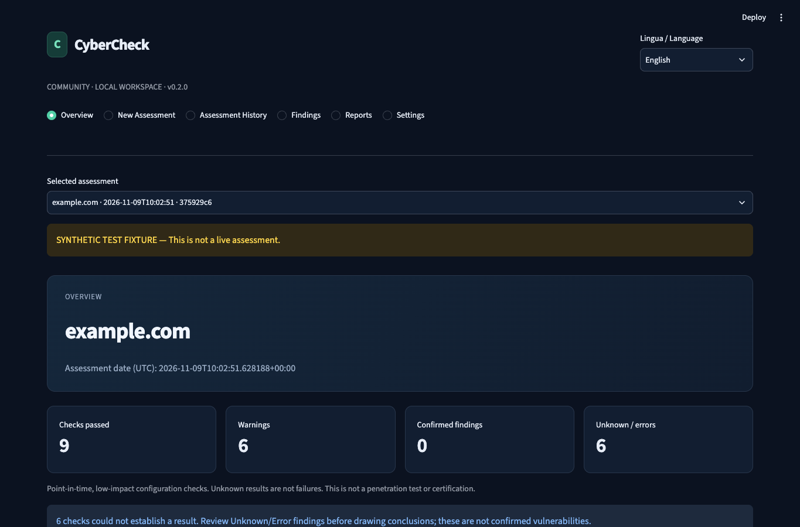

# CyberCheck

**Local domain security configuration checks, with evidence and practical next steps.**

**[🇮🇹 Italian Guide — Learn how CyberCheck works, module by module](docs/GUIDA_ITALIANA.md)**

CyberCheck is an open-source, local security configuration assessment tool for small businesses, developers, freelancers and IT service providers. It helps users understand selected weaknesses and misconfigurations associated with a domain they own or are explicitly authorized to assess.

It brings DNS, email and web observations into a dashboard with explanations and recommended actions. Business owners can see what needs review, while IT professionals can inspect the supporting technical evidence. The interface and HTML reports support Italian (default) and English.

This is a configuration assessment, **not a penetration test, certification, compliance attestation or guarantee of security**.

## How CyberCheck Works

An assessment starts with one domain and the user's confirmation of ownership or authorization. The engine then runs six stages:

1. **DNS inspection:** Queries publicly resolvable A, AAAA, NS, MX and CAA records to inventory domain addresses, nameservers, mail routing and published certificate-authority settings. CAA inspection is limited to the exact assessed name.
2. **SPF analysis:** Reads the email sender authorization policy, checks common syntax problems, multiple records and policy qualifiers, and inspects selected `include`/`redirect` dependencies. Lookup complexity is a bounded static estimate, not a full sender-specific SPF evaluation.
3. **DMARC analysis:** Examines published policies, reporting settings and organizational-domain inheritance using the **legacy RFC 7489 implementation**. Full current RFC 9989 discovery and testing behavior is not implemented; records with `np`, `psd` or `t` markers remain inconclusive.
4. **DKIM inspection:** Queries public key records for up to five user-supplied selectors. It does not guess selectors or verify that real messages are signed, that published keys are cryptographically valid, or that messages meet alignment requirements. Without a selector, DKIM remains unknown.
5. **TLS verification:** Performs one verified TLS handshake on port 443, checking the certificate chain against the local trust store and matching the requested hostname. It records the issuer, validity period, expiration and negotiated protocol; it does not enumerate every supported TLS version.
6. **HTTP security analysis:** Uses bounded HTTP `HEAD` requests on ports 80/443 to observe HTTPS connectivity, redirects and selected browser security headers, including HSTS, CSP and framing controls. After HTTPS HEAD 405/501, a GET fallback can be explicitly authorized. Redirect destinations are validated before connection; response bodies are not inspected.

CyberCheck gathers observable technical evidence and evaluates it using deterministic rules in Python. It does not use AI to invent findings or predict vulnerabilities.

## CyberCheck Architecture & Assessment Modules — Visual Overview

The first map follows one assessment from input to results. The engine runs six modules in order and collects their findings. Storage, the dashboard and report generation are supporting components, separate from the security checks.

### Diagram 1 — How CyberCheck Works



Authorization is the user's declaration, not independent proof of ownership. The module arrows show execution order; each module contributes its own findings. The three supporting components use those collected results.

### Diagram 2 — What Each Module Actually Checks

Each branch names a module, its purpose and the evidence it inspects. The branches form a vertical list to keep the map readable on smaller screens.



| Module | What it checks | What it does NOT check |
|---|---|---|
| **DNS** | A/AAAA addresses, NS nameservers, MX mail routing/null MX, and CAA at the exact name. | DNSSEC validation, effective inherited CAA policy or mail server reachability. |
| **SPF** | Published SPF records, common syntax errors, sender policy qualifiers and selected DNS dependencies; a bounded lookup estimate. | Full sender-IP evaluation, macro expansion or every void/MX/PTR lookup-limit case. |
| **DMARC** | Published policy, reporting settings and inheritance under the legacy RFC 7489 model. | Full RFC 9989 discovery/testing, message alignment, report delivery or external-report authorization. |
| **DKIM** | Public key records and supported key-tag/base64 checks for up to five explicitly supplied selectors. | Selector discovery, full cryptographic key validation, actual message signatures or alignment. |
| **TLS** | One verified handshake: local trust chain, hostname, certificate validity/expiration and negotiated protocol. | Revocation, Certificate Transparency, enumeration of all protocols/ciphers or vulnerability exploitation. |
| **HTTP** | Bounded HEAD requests, with optional HTTPS GET fallback after HEAD 405/501: HTTPS connectivity, application response, redirects and browser security headers. | Page bodies, authenticated application tests, comprehensive availability monitoring or full CSP/Permissions-Policy effectiveness. |

A published policy or key is evidence of configuration, not proof that real email or application behavior is secure. Incomplete checks remain inconclusive. See the [methodology](docs/METHODOLOGY.md) for the detailed interpretation limits.

## Understanding the results

Each finding provides:

- **Status:** Whether the check passed, failed, needs review, could not establish a result, encountered an error or does not apply.
- **Severity:** The potential consequence of the observed issue, from Informational to Critical; it is not an organization-wide risk rating.
- **Technical evidence:** Relevant DNS records, certificate details or HTTP observations, with sensitive web data minimized or redacted.
- **Explanation:** What was observed and why it may matter to the business or service.
- **Suggested remediation:** Practical next steps to review with the responsible administrator or provider.

A warning does not automatically mean an exploitable vulnerability. A timeout can leave a check Unknown without proving an insecure configuration. The [status definitions and scoring rules](#statuses-and-score) explain these distinctions and the optional Configuration Health score.

Assessments are saved locally in SQLite. Users can compare consecutive runs for the same domain and export printable HTML or JSON reports containing findings, evidence, remediation and limitations.

## What is included

- SPF discovery, multiple-record and common syntax checks, qualifier inspection, and a bounded static estimate of include/redirect lookup paths.
- Legacy RFC 7489 DMARC policy/percentage, reporting configuration and PSL-based inheritance. Current-standard np/psd/t markers remain inconclusive; this is not a complete RFC 9989 receiver implementation.
- DKIM queries for up to five **explicitly supplied** selectors. No selector guessing; unknown does not mean disabled.
- A/AAAA, NS, MX/null-MX and exact-name CAA observations.
- One verified TLS handshake: trust-chain acceptance, hostname, issuer, validity, expiration and negotiated protocol.
- HTTPS connectivity, bounded HTTP-to-HTTPS redirect checks and six browser security-header observations.
- Searchable/filterable findings with severity, status, timestamps, evidence and specific remediation.
- Local history, consecutive-assessment comparison, printable HTML and evidence-preserving JSON.
- An optional transparent Configuration Health score with visible evaluation coverage.
- A CLI, deterministic offline tests and GitHub Actions.

There are no paid APIs, accounts, payments, mandatory cloud services or hardcoded assessment results. Empty installations start with no assessments.

## Scope and current limitations

CyberCheck checks selected public domain configurations. It is not a penetration-testing platform or a comprehensive vulnerability scanner. It does not exploit vulnerabilities, scan ports or perform authenticated application testing, and it does not require administrator credentials.

Ownership or explicit authorization is required for every assessment. The authorization declaration is not an independent ownership check. **Independent live-domain validation has not yet been completed:** no developer-owned or otherwise authorized domain was available. Mocked tests and synthetic examples do not establish real-world detection accuracy.

The current MVP assesses one domain per run. Automated monitoring, alerts, multi-domain management and paid hosting are future possibilities described in the [roadmap](docs/ROADMAP.md), rather than current product features.

**v0.2 is a reliability and security review of the existing MVP.** See the [technical audit](docs/TECHNICAL_AUDIT_V02.md), [executed validation](docs/VALIDATION.md) and [real-world validation procedure/status](docs/REAL_WORLD_VALIDATION.md). The [methodology](docs/METHODOLOGY.md) documents the limits of the current checks, including legacy DMARC support and single-endpoint sampling.

## Install on macOS

Use Python 3.12 or newer. Python 3.13 is the locally verified baseline; CI is configured for 3.12, 3.13 and 3.14.

```sh
brew install python@3.13
cd /path/to/Cybercheck
python3.13 -m venv .venv
source .venv/bin/activate
python -m pip install -r requirements.lock
python -m pip install --no-deps -e .
streamlit run streamlit_app.py
```

Open **http://127.0.0.1:8501**. If the virtual environment already exists, activate it and run the Streamlit command. The server binds to loopback and disables analytics by default. Stop it with `Ctrl+C`. Python 3.13 installation from a fresh temporary venv was executed for this release; see the validation record.

For development using supported dependency ranges instead of the tested version snapshot:

```sh
python -m pip install -e '.[dev,audit]'
```

`requirements.lock` includes development/security tools and exact resolved versions. It is a tested version snapshot, not a hash-verified supply-chain lock; CI uses it on its Python matrix. Streamlit's minimum is now 1.67, matching the API baseline actually tested. `pyproject.toml` defines supported ranges. No environment file is required. Optional shell settings are shown in [.env.example](.env.example); `.env` is not automatically loaded.

## Use the application

1. Open **Nuovo assessment / New Assessment**.
2. Enter a fully qualified domain, without scheme, path, credentials or port.
3. Optionally enter DKIM selectors obtained from the mail provider or a signed message.
4. Confirm ownership or explicit authorization, including related redirects within the organizational domain.
5. Start the assessment. Results are saved locally when complete.
6. Use the top navigation for overview, history, findings, reports and settings. Select Italian or English at the top right.
7. Download HTML or JSON. Open HTML in a browser to print or use its **Save as PDF** print destination. There is no native PDF renderer.

The assessment selector controls which saved run is shown. History compares the selected run with the immediately preceding run for that domain. Evidence changes are observations; they are not automatically security regressions. History is paginated, 25 assessments per page.

## CLI

Replace `your-owned-domain.tld` with an asset you are authorized to assess:

```sh
cybercheck your-owned-domain.tld --authorized --selectors selector1,selector2 --language en --output exports
```

The authorization flag is mandatory. Omit selectors if unknown. GET fallback requires the separate `--allow-get-fallback` flag; `--authorized` alone does not enable it. Add `--include-score` to include the optional health score in HTML. A completed assessment can contain unknown/error findings; the CLI prints counts and exports evidence, rather than treating network uncertainty as a confirmed vulnerability.

`cybercheck --version` prints the installed version. If history persistence fails after export, the CLI returns a nonzero exit status and explicitly reports that the HTML/JSON files are available. Export files are created owner-only and never overwrite an existing file or follow its symlink.

## Servers that reject HEAD and optional GET fallback

Some servers implement normal page visits (`GET`) but reject the lighter `HEAD` request. `405 Method Not Allowed` means this method is not allowed for that resource; `501 Not Implemented` can mean the server does not implement it. Neither response alone proves a security vulnerability or that the application is unavailable to browsers.

CyberCheck separates three observations:

- **HTTPS connectivity:** a verified HTTPS connection returned an HTTP response, even if its status was 501. This does not prove the application is working.
- **Application response:** a final 2xx response was observed for the stated method and URL. Other statuses and request failures remain Unknown, without declaring a vulnerability. A 2xx response still does not verify login, business functions or the whole site.
- **Security headers:** evaluated on the final eligible HTTPS 2xx response, with existing content-type applicability rules. Error responses leave the six checks Unknown.

GET fallback is **disabled by default**, because GET can trigger actions in poorly designed applications. Obtain authorization for GET and permitted redirects before enabling it. In **New Assessment**, select the separate optional GET checkbox, or use:

```sh
cybercheck your-owned-domain.tld --authorized --allow-get-fallback --language en
```

For Python callers, use `Settings(allow_get_fallback=True)` alongside the mandatory assessment authorization. The setting is per assessment; no environment variable silently enables GET.

After HTTPS HEAD returns 405 or 501, one GET fallback chain starts at that final HEAD URL. The separate HTTP-to-HTTPS redirect check continues to use HEAD. Every GET hop requires HTTPS, the authorized organizational domain (including shared-hosting tenant boundaries), public DNS addresses, IP pinning and normal certificate/hostname verification. HEAD and fallback GET share the redirect allowance; all requests use the existing DNS/HTTP budgets and overall deadline. There are no retries or fallback loops, and no credentials, cookies, authentication tokens or Range header are sent.

The request streams headers and closes immediately without reading or storing the response body stream. This cannot prevent the server from generating/sending a body or the socket from receiving some body bytes together with headers; those bytes are discarded. It does not prevent GET side effects, guarantee HEAD and GET return identical headers, or ensure the response represents the origin rather than a CDN. GET may consume the remaining request budget and leave later checks inconclusive. If fallback is disabled, blocked, unsuccessful or returns non-2xx, application availability and headers remain Unknown.

For the observed HEAD 501 scenario (illustrative, without another live assessment):

| Behavior | Before | After |
|---|---|---|
| HEAD 501, default settings | “HTTPS endpoint” Passed; six headers Unknown | “HTTPS connectivity” Passed with HTTP 501 recorded; application response Unknown; GET explicitly reported as skipped; six headers Unknown |
| HEAD 501, authorized fallback GET 200 | No GET available | HTTPS connectivity recorded separately; application response Passed for GET 200; security headers evaluated from the final GET response |
| HEAD 501, fallback blocked or fails | No GET available | Original HTTPS connectivity preserved; fallback outcome explained; application response and headers Unknown |

HTML and JSON retain schema version 1. The existing `http.https` ID now has the clearer title “HTTPS connectivity”; the new informational, unscored `http.application` finding adds one result per assessment, so counts can differ from older runs. Evidence adds `http_observation` (HEAD status, unsupported-method indication, fallback outcome and header eligibility), and redirect hops record their method. Metadata retains `http_method: HEAD` as the initial method and adds `get_fallback_enabled`; actual methods are in findings and hops. Stored older assessments remain readable and are not reclassified retroactively.

## Statuses and score

| Status | Meaning |
|---|---|
| Passed | The stated, limited check met its criterion. |
| Failed | Evidence confirms the stated configuration problem. |
| Warning | Contextual hardening, rollout or operational concern; review applicability. |
| Unknown | Insufficient evidence, blocked request or network failure. |
| Error | Unexpected local execution failure in a module. |
| Not applicable | The check does not apply to the observed content. |

Severity describes the potential consequence **of that observation**, not organization-wide risk. `p=none`, missing headers and optional CAA are not classified as critical. `-all` is not prescribed universally. DKIM key publication does not prove message signing, key cryptographic validity or alignment.

The optional score is **100 × passed / (passed + failed)** among explicitly scoreable checks. Warnings, unknowns, errors, inapplicable checks and informational presence-only checks are excluded. An empty denominator yields no score. The UI keeps the score off by default and always shows its coverage when enabled. A high score with low coverage or unscored warnings is incomplete information, **not a probability of avoiding compromise**. See [methodology](docs/METHODOLOGY.md).

## Local data and configuration

Results are stored in `data/cybercheck.sqlite3`, excluded from Git. New database/report files are created owner-only before content is written; final symlinks are refused. Parent directories are trusted local configuration. Future database schemas are rejected without downgrading their version. Unreadable assessments are preserved with a recovery message. Back up the database while the application is stopped. There is no retention scheduler or authentication layer in this local release.

New HTTP evidence retains only relevant header fields; cookies, arbitrary response headers, credentials, URL query values and fragments are omitted/redacted. Exports and UI also redact web evidence read from v0.1 history without rewriting the stored source. Paths, DNS and original v0.1 databases/reports can still be sensitive; do not commit or share raw customer artifacts. If a UI save fails, download the result or use **Retry saving results**, which does not rerun network checks.

| Variable | Default | Allowed range |
|---|---:|---|
| `CYBERCHECK_DB` | `data/cybercheck.sqlite3` | Local path |
| `CYBERCHECK_TIMEOUT` | 5 seconds | 0.1–15 seconds |
| `CYBERCHECK_MAX_DNS` | 48 | 8–100 queries |
| `CYBERCHECK_MAX_HTTP` | 8 | 2–20 requests |
| `CYBERCHECK_MAX_REDIRECTS` | 3 | 0–5 hops per chain; shared by HTTPS HEAD and its GET fallback |
| `CYBERCHECK_MAX_SECONDS` | 90 | 10–180 seconds |

Queries are sequential and bounded; DNS answers are cached per assessment. HTTP socket operations recheck the overall deadline and limit header reads to 64 KiB. One dedicated TLS handshake is attempted; HTTPS HEAD/GET requests also perform verified TLS handshakes. Limits reset for each assessment; this is not a rate-limited public service.

## Security boundaries

- Public targets only. Localhost, IP-literal inputs, private, loopback, link-local, reserved, multicast, IPv6 zone identifiers and transition/special-purpose ranges are rejected. Special ranges are blocked consistently across supported Python versions, including conservative exclusion of a few special-purpose global exceptions.
- Every HTTP redirect is validated, including DNS resolution and port checks, before connection. Cross-organizational-domain redirects and HTTPS downgrades are blocked.
- All A/AAAA results must be public; partial DNS-family failures fail closed. Connections use a validated literal IP, with the original Host header and TLS SNI/hostname verification. No second hostname resolution can change the network destination.
- Proxy environment variables are ignored. No insecure certificate retry, GET body download, arbitrary shell command, user-defined port, exploitation, port scan or subdomain enumeration.
- The configured local recursive DNS resolver is trusted infrastructure and may itself be private. It is not chosen by target input. The tool does not claim DNSSEC authenticity.
- Authorization is a user declaration, not a verified ownership challenge. Outbound traffic originates on your machine.
- Keep the server on localhost. Public hosting requires authentication, per-user limits, ownership verification, egress isolation and a separate security review.

See [architecture](docs/ARCHITECTURE.md), [methodology](docs/METHODOLOGY.md) and [security policy](SECURITY.md).

## Test and verify

```sh
python -m pytest -q --cov=cybercheck --cov-report=term-missing
ruff check .
ruff format --check .
python -m pip check
pip-audit -r requirements.lock --no-deps --disable-pip --progress-spinner off
```

Tests prohibit outbound socket/DNS connections. They cover validation/SSRF, DNS failures, email policies, TLS verification, the real transport adapter through a memory backend, slow/oversized headers, redirects, cookie/token redaction, report escaping, schema preservation, stable history comparison, CLI output/save failures and Streamlit navigation/forms in both languages. Resource leaks fail the tests. GitHub Actions runs the locked environment on Python 3.12/3.13/3.14 plus an advisory-audit job; local execution does not establish remote CI status.

`pip check` verifies dependency compatibility; `pip-audit` performs a separate network-backed advisory lookup. A service outage is not a clean audit. The successful scan is a point-in-time result, not a guarantee against unknown vulnerabilities. See [developer verification](docs/DEVELOPMENT.md) for optional Chrome/print checks, which do not add a runtime browser or PDF dependency.

No live assessment of third-party domains is required for tests. The local application server can be checked without assessing a domain:

```sh
curl --fail http://127.0.0.1:8501/_stcore/health
```

See [the local validation record](docs/VALIDATION.md) for executed checks and the boundary between mocked verification and live assessment.

## Example output and screenshots

The following screenshot is from the real v0.2 dashboard using an isolated, **labeled synthetic fixture**. It is not a live domain assessment. [Mobile screenshot](docs/screenshots/v02-overview-mobile.png).



[Example HTML](docs/examples/assessment.html) and [example JSON](docs/examples/assessment.json) are **explicitly synthetic test fixtures, not live observations**. TLS is deliberately unavailable in the fixture; no certificate is fabricated. They are generated offline through the real engine and report renderers:

```sh
python scripts/generate_examples.py
```

For README/product screenshots, start the app, use your own authorized domain, hide sensitive record values as appropriate, and capture Overview, Findings and Reports at desktop width and one mobile width. Store reviewed images under `docs/screenshots/` and add relative image links here. Label synthetic screenshots if test fixtures are ever used; do not present them as customer evidence. Screenshots are not generated from an unauthorized live assessment.

## License and commercial direction

The public project uses **AGPL-3.0-or-later**, unchanged in v0.2. It encourages contribution of covered modifications, including the source offer for modified versions used over a network. It **does not prevent competitors from hosting, distributing or selling compliant copies**. MIT would be a different, permissive licensing choice requiring the maintainer's approval and the necessary rights; this audit does not relicense anything. See the [licensing considerations](docs/LICENSING.md) and [official AGPL text](https://www.gnu.org/licenses/agpl-3.0.html).

The complete community assessment engine remains usable. Future paid value can come from monitoring, operational workflows, managed hosting, support and branding. No paid feature, payment service or multi-tenant architecture is implemented. See [roadmap and commercial validation](docs/ROADMAP.md).

The repository is public at [LucaTortoriello/CyberCheck](https://github.com/LucaTortoriello/CyberCheck). Installing or running it does not provision a cloud or paid service. Feature branches and draft pull requests are separate from approving a release or deploying an application.
