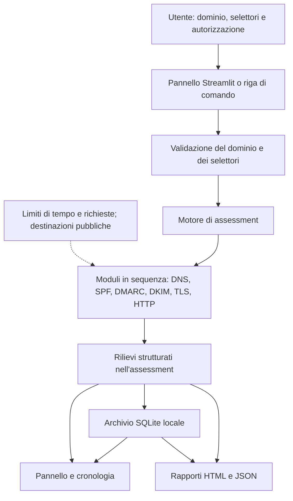

# CyberCheck: guida italiana per capire i controlli

Questa guida accompagna chi studia sicurezza informatica e ha poca esperienza di programmazione. Spiega i concetti, mostra piccoli esempi e li collega al codice di CyberCheck v0.2. Non serve conoscere Python per seguirla: i nomi delle funzioni permettono di ritrovare nel repository il comportamento descritto.

Tutti i domini, gli indirizzi e i risultati degli esempi sono **fittizi e didattici**. Il suffisso `.example` e gli indirizzi `192.0.2.0/24` e `2001:db8::/32` servono alla documentazione: non sono bersagli da interrogare. CyberCheck blocca le connessioni a indirizzi riservati; questi esempi non sono scansioni eseguibili né osservazioni raccolte su Internet.

Puoi leggere i capitoli in ordine, poi svolgere gli esercizi senza guardare subito le risposte. Per un confronto con la documentazione tecnica in inglese, consulta la [metodologia](METHODOLOGY.md) e il [README](../README.md).

## Indice

1. [Cosa fa CyberCheck](#1-cosa-fa-cybercheck)
2. [Architettura di CyberCheck](#2-architettura-di-cybercheck)
3. [Modulo DNS](#3-modulo-dns)
4. [Modulo SPF](#4-modulo-spf)
5. [Modulo DMARC](#5-modulo-dmarc)
6. [Modulo DKIM](#6-modulo-dkim)
7. [Modulo TLS e HTTPS](#7-modulo-tls-e-https)
8. [Modulo di sicurezza HTTP](#8-modulo-di-sicurezza-http)
9. [Come leggere i risultati](#9-come-leggere-i-risultati)
10. [Esercizi pratici](#10-esercizi-pratici)
11. [Glossario](#11-glossario)

## 1. Cosa fa CyberCheck

Un **dominio** è un nome, come `azienda.example`, usato per identificare servizi su Internet. La sua configurazione comprende indicazioni per trovare i server, gestire la posta e collegarsi al sito. Un **assessment delle configurazioni di sicurezza** osserva alcune di queste impostazioni e le confronta con criteri espliciti: per esempio, controlla se un certificato è accettato dalla macchina che esegue la verifica.

Un'organizzazione può cambiare hosting, aggiungere un servizio di invio email o dimenticare un rinnovo. Controlli periodici aiutano a individuare impostazioni contraddittorie, errori e misure di protezione da valutare. CyberCheck raccoglie queste osservazioni in un unico risultato, con spiegazioni e indicazioni di correzione.

Le evidenze provengono da risposte DNS pubblicamente risolvibili, da una connessione TLS verificata e da richieste HTTP limitate. Non sono deduzioni prodotte da un modello di intelligenza artificiale. Le regole sono definite nel codice Python e producono **rilievi**, chiamati anche *finding*: ciascuno documenta un controllo e il suo esito.

Il programma può rilevare, fra l'altro, più record SPF concorrenti, un Null MX in conflitto con altri MX o un certificato che non corrisponde al nome richiesto. Può segnalare intestazioni web mancanti, ma non dimostra per questo che il sito sia sfruttabile. Non cerca malware, password deboli, errori nella logica del sito o vulnerabilità del suo codice. Non legge messaggi email reali, non sfrutta falle e non certifica la sicurezza complessiva.

### Tre attività diverse

| Attività | Domanda principale | Rapporto con CyberCheck |
|---|---|---|
| Assessment delle configurazioni | «Quali impostazioni pubbliche osservo e quali problemi documentano?» | È lo scopo dell'applicazione, entro sei moduli definiti. |
| Scansione delle vulnerabilità | «Ci sono servizi o componenti con debolezze note o rilevabili?» | CyberCheck non è uno scanner completo e non cerca versioni vulnerabili dei prodotti. |
| Test di penetrazione | «Un attaccante può sfruttare concretamente una debolezza entro un perimetro concordato?» | Richiede attività e competenze ulteriori; CyberCheck non tenta lo sfruttamento. |

Le informazioni sono pubbliche, ma le richieste DNS, TLS e HTTP generano traffico: non si tratta di un'analisi interamente passiva. Occorre possedere il dominio o avere un'autorizzazione esplicita, comprendendo gli eventuali reindirizzamenti consentiti. In `run_assessment()` l'assenza di autorizzazione interrompe l'esecuzione. La conferma dell'utente è una dichiarazione: l'app non dimostra autonomamente la proprietà del dominio.

**Esempio.** L'organizzazione immaginaria Azienda sposta `azienda.example` su un nuovo hosting. Un assessment potrebbe osservare HTTPS funzionante e un certificato prossimo alla scadenza. L'amministratore verificherebbe il rinnovo automatico: l'avviso non proverebbe né un'intrusione né l'assenza di altri problemi. Se un controllo DNS non rispondesse, la conclusione sarebbe «non accertato», non «dominio insicuro».

## 2. Architettura di CyberCheck

### Le parole necessarie

Un **modulo Python** è un file che raggruppa istruzioni e funzioni. Una **funzione** riceve dati, svolge un compito e può restituire un risultato. Per esempio, `normalize_domain()` controlla e normalizza il nome inserito.

Un'**API**, o interfaccia di programmazione, è un accordo su come un componente può chiamarne un altro. `run_assessment()` è l'interfaccia usata dal pannello e dalla riga di comando per avviare il motore. Questo non implica che CyberCheck esponga un servizio pubblico con un'API REST.

Una **query DNS** è una domanda su un nome e un tipo di record. Un **handshake TLS** è lo scambio iniziale con cui client e server stabiliscono una connessione cifrata e verificano le informazioni richieste. Una **richiesta HTTP** domanda a un server una risorsa o le sue informazioni. Un **database** conserva dati in forma organizzata; **SQLite** li gestisce in un file locale, senza un server separato.

### Dall'inserimento al risultato

L'utente inserisce un dominio, eventuali selettori DKIM e la conferma di autorizzazione. Il nome deve essere privo di schema, percorso, credenziali e porta: si inserisce `azienda.example`, non `https://azienda.example/login`.

Il motore normalizza l'input e chiama, **in sequenza**, DNS, SPF, DMARC, DKIM, TLS e HTTP. Ogni modulo aggiunge rilievi a un oggetto `Assessment`, cioè un contenitore dell'intera esecuzione. Un errore locale inatteso in un modulo diventa un rilievo di errore e non cancella quelli già raccolti.



La freccia verso SQLite descrive il salvataggio eseguito dal pannello o dalla riga di comando, non dal motore. Il risultato appena calcolato può essere mostrato ed esportato anche prima di rileggerlo dal database. In particolare, la riga di comando esporta i rapporti prima di salvare la cronologia; un errore di salvataggio viene segnalato separatamente.

### Dove trovare ogni responsabilità

| File reale | Componenti principali e responsabilità |
|---|---|
| [streamlit_app.py](../streamlit_app.py) | Avvia `main()` del pannello. Streamlit è la libreria che costruisce l'interfaccia locale nel browser. |
| [cybercheck/app/dashboard.py](../cybercheck/app/dashboard.py) | `new_assessment()` raccoglie l'input, avvia il motore e salva; `overview()`, `findings_view()`, `history_view()` e `reports_view()` presentano risultati, confronti ed esportazioni. |
| [cybercheck/cli.py](../cybercheck/cli.py) | `main()` gestisce la riga di comando, richiede `--authorized`, esporta e salva. |
| [cybercheck/core/validation.py](../cybercheck/core/validation.py) | `normalize_domain()`, `normalize_selectors()`, `public_ip()` e `validate_url()` controllano nomi e destinazioni. |
| [cybercheck/core/engine.py](../cybercheck/core/engine.py) | `run_assessment()` coordina i sei moduli e raccoglie gli esiti. Non gestisce interfaccia o archivio. |
| [cybercheck/core/config.py](../cybercheck/core/config.py) | `Settings` contiene la configurazione; `Budget` conta richieste e tempo disponibile. |
| [cybercheck/core/dns.py](../cybercheck/core/dns.py) | `DNSClient.query()` interroga il DNS e conserva temporaneamente le risposte; `public_addresses()` verifica gli indirizzi prima delle connessioni. |
| [cybercheck/checks/email.py](../cybercheck/checks/email.py) | `check_dns()`, `check_spf()`, `check_dmarc()` e `check_dkim()` valutano DNS e configurazioni email. I quattro moduli logici condividono questo file. |
| [cybercheck/checks/tls.py](../cybercheck/checks/tls.py) | `check_tls()` esegue il controllo dedicato al certificato e al protocollo negoziato. |
| [cybercheck/core/network.py](../cybercheck/core/network.py) | `WebClient.fetch()` gestisce richieste e reindirizzamenti; `organizational_domain()` individua il dominio organizzativo tramite una lista dei suffissi pubblici inclusa. |
| [cybercheck/core/transport.py](../cybercheck/core/transport.py) | `PinnedTransport`, `DeadlineBackend` e `DeadlineStream` effettuano le connessioni agli IP già validati e limitano le letture. |
| [cybercheck/checks/web.py](../cybercheck/checks/web.py) e [cybercheck/checks/headers.py](../cybercheck/checks/headers.py) | `check_web()` osserva HTTPS e reindirizzamenti; `check_headers()` valuta le intestazioni. Insieme costituiscono il modulo HTTP. |
| [cybercheck/models/assessment.py](../cybercheck/models/assessment.py) | `Finding`, `Assessment`, `Status` e `Severity` definiscono i dati; `Assessment.health` calcola punteggio e copertura. |
| [cybercheck/locales/findings.py](../cybercheck/locales/findings.py) | `finding()` costruisce rilievi con testi, riferimenti e indicazioni di correzione nelle due lingue supportate. |
| [cybercheck/core/evidence.py](../cybercheck/core/evidence.py) | Riduce e oscura dati web sensibili nelle evidenze. |
| [cybercheck/storage/sqlite.py](../cybercheck/storage/sqlite.py) | `Repository.save()`, `get()`, `list()` e `previous()` gestiscono la cronologia; `compare()` confronta due esecuzioni dello stesso dominio. |
| [cybercheck/reports/render.py](../cybercheck/reports/render.py) | `render_html()` e `render_json()` generano i rapporti; `report_view()` prepara una copia con evidenze web filtrate. |

### Limiti operativi e destinazioni

I valori predefiniti sono 48 query DNS, 8 richieste HTTP, 3 reindirizzamenti per catena, 5 secondi di timeout per operazione e 90 secondi complessivi. Una risposta DNS già ottenuta viene riutilizzata durante lo stesso assessment. Esaurire un limite può lasciare un controllo sconosciuto.

Prima delle connessioni, tutti gli indirizzi A/AAAA restituiti devono essere pubblici; anche un errore parziale di risoluzione impedisce di procedere. Il programma si collega al primo IP validato mantenendo il nome originale per HTTP e TLS. Ciò limita il rischio che una nuova risoluzione cambi la destinazione dopo il controllo.

Sono consentite le porte web 80 e 443. Ogni reindirizzamento viene controllato prima del collegamento: sono bloccati gli indirizzi non pubblici, le destinazioni fuori dal dominio organizzativo autorizzato e i passaggi da HTTPS a HTTP. La lista dei suffissi pubblici serve a riconoscere questo confine senza scaricarla durante l'esecuzione. Il resolver DNS locale, cioè il servizio che risponde alle query, è infrastruttura fidata e può essere privato: la restrizione sugli IP riguarda le destinazioni web e TLS.

## 3. Modulo DNS

Il **Domain Name System**, DNS, associa nomi a informazioni tecniche. Evita di dover ricordare gli indirizzi numerici dei server e permette di cambiare infrastruttura mantenendo lo stesso nome. Un **record DNS** è una voce di questa rubrica distribuita.

### Record da riconoscere

| Tipo | Significato | Esempio fittizio |
|---|---|---|
| A | Indirizzo IPv4: quattro numeri separati da punti. | `azienda.example. IN A 192.0.2.10` |
| AAAA | Indirizzo IPv6: rappresentazione esadecimale più lunga. | `azienda.example. IN AAAA 2001:db8::10` |
| NS | Nome di un server autorevole per una zona DNS. | `azienda.example. IN NS ns1.azienda.example.` |
| MX | Server a cui indirizzare la posta in arrivo, con priorità numerica. | `azienda.example. IN MX 10 posta.azienda.example.` |
| CAA | Indicazione sulle autorità autorizzate a emettere certificati. | `azienda.example. IN CAA 0 issue "ca.example"` |

`IN` indica la classe Internet; il punto finale identifica un nome completo. Nel record MX un numero più basso indica una preferenza maggiore. A e AAAA possono coesistere: non indicano automaticamente due servizi diversi. NS può mancare sul nome `www.azienda.example` senza problemi, perché la delega può trovarsi sull'apice della zona, `azienda.example`.

Il CAA dell'esempio indica un emittente immaginario. Non crea un certificato e non sostituisce il controllo del certificato durante TLS. I valori reali dipendono dall'autorità scelta e dal funzionamento del rinnovo.

Un **Null MX** dichiara esplicitamente che il dominio non riceve posta:

```dns
azienda.example. IN MX 0 .
```

Non deve convivere con altri MX. L'assenza di MX è diversa: può permettere l'instradamento implicito verso A/AAAA. Inoltre «non riceve posta» non significa «non invia posta»: Null MX non sostituisce SPF e DMARC.

### Come ragiona CyberCheck

`check_dns()` richiede A, AAAA, NS, MX e CAA **al nome esatto inserito**. Produce tre rilievi: inventario, instradamento MX e CAA. L'inventario può risultare superato anche se un tipo di record è assente: documenta una raccolta completata, non l'obbligo di pubblicare tutti i tipi.

`DNSClient.query()` distingue una risposta disponibile (`ok`), l'assenza del tipo richiesto (`absent`), il nome inesistente (`nxdomain`) e un errore di interrogazione (`error`). Se una query dell'inventario fallisce o restituisce nome inesistente, l'inventario rimane sconosciuto. Un timeout non dimostra che il record sia assente.

Un Null MX insieme ad altri MX è un errore confermato, di gravità media. MX presenti o un singolo Null MX superano il controllo limitato di instradamento; nessun MX esplicito genera un avviso informativo. CAA presenti superano una verifica di pubblicazione; CAA assenti producono un avviso informativo.

Il modulo non verifica DNSSEC, cioè l'autenticità crittografica delle risposte DNS, né la coerenza fra tutti i server autorevoli. Non prova che un server di posta sia raggiungibile. Non ricostruisce il CAA effettivo ereditato da nomi superiori o attraverso alias CNAME: «CAA assente al nome esatto» non significa «nessuna restrizione di emissione».

## 4. Modulo SPF

Lo **spoofing email** consiste nel falsificare un'identità del mittente. La posta contiene più identità: il campo `From`, visibile al lettore, e il mittente della busta SMTP, usato dai server per il trasporto e gli errori di consegna. SMTP è il protocollo di trasferimento della posta.

**SPF**, Sender Policy Framework, permette a un dominio di dichiarare quali server possono usarlo come identità SMTP, in particolare nel mittente della busta o nel saluto HELO. Non autentica direttamente il campo `From`, non firma il contenuto e non cifra il messaggio. Un inoltro può cambiare l'IP che il destinatario vede e complicare la valutazione SPF.

La policy si pubblica come record TXT, cioè testo nel DNS, che comincia con `v=spf1`. Un destinatario che valuta SPF considera l'indirizzo del server mittente e percorre i termini in ordine. I dettagli del protocollo sono definiti in [RFC 7208](https://www.rfc-editor.org/rfc/rfc7208.html).

### Termini e qualificatori

| Termine | Come leggerlo |
|---|---|
| `ip4:192.0.2.10` | Corrisponde a quell'indirizzo IPv4; `/24` dopo un indirizzo descrive una rete. |
| `ip6:2001:db8::/32` | Corrisponde a una rete IPv6. |
| `include:_spf.fornitore.example` | Valuta la policy indicata: con il qualificatore positivo predefinito, autorizza se la valutazione inclusa restituisce un esito positivo. Non copia semplicemente del testo. |
| `redirect=posta.example` | Delega la valutazione finale a un'altra policy quando nessun meccanismo precedente corrisponde. Un meccanismo `all` rende inoperante questa delega. |
| `all` | Corrisponde a qualunque mittente ancora non intercettato: conta il qualificatore che lo precede. |

| Forma | Significato per un mittente arrivato a quel termine |
|---|---|
| `-all` | Esito SPF negativo: il mittente non è autorizzato dalla policy. Non è un ordine universale di cancellare il messaggio. |
| `~all` | Esito negativo attenuato, detto *softfail*: il dominio esprime una preferenza meno netta, utile in alcuni passaggi graduali. |
| `?all` | Esito neutro: nessuna affermazione sull'autorizzazione. |
| `+all` oppure `all` | Esito positivo per qualunque mittente non già intercettato: rende la policy permissiva. |

La scelta fra `~all` e `-all` richiede conoscere tutti i mittenti legittimi. Passare a `-all` senza questo inventario può danneggiare la consegna; CyberCheck non lo impone a tutti i domini.

### Quattro esempi da leggere

**1. Un solo server e una rete IPv6.**

```dns
azienda.example. IN TXT "v=spf1 ip4:192.0.2.10 ip6:2001:db8::/32 -all"
```

La policy autorizza il server IPv4 e la rete IPv6 indicati. Gli altri mittenti arrivano a `-all`. CyberCheck può superare le verifiche comuni di sintassi, senza aver valutato un messaggio specifico.

**2. Un fornitore e un'introduzione graduale.**

```dns
azienda.example. IN TXT "v=spf1 include:_spf.fornitore.example ~all"
_spf.fornitore.example. IN TXT "v=spf1 ip4:192.0.2.20 -all"
```

Un mittente autorizzato dalla policy inclusa può superare SPF; gli altri arrivano al softfail della policy esterna. CyberCheck legge la dipendenza per stimare la complessità. Se non riesce a leggerla, può lasciare sconosciuta la stima pur avendo completato le verifiche comuni sul record principale.

**3. Una policy troppo permissiva.**

```dns
azienda.example. IN TXT "v=spf1 ip4:192.0.2.10 +all"
```

Anche i mittenti diversi da quello elencato ottengono un esito positivo arrivando a `+all`. Il rilievo SPF è fallito, di gravità alta. La gravità non implica automaticamente l'inclusione nel punteggio.

**4. Delega completa.**

```dns
azienda.example. IN TXT "v=spf1 redirect=posta.example"
posta.example. IN TXT "v=spf1 ip4:192.0.2.30 -all"
```

Il dominio delega alla seconda policy. Aggiungere `all` alla prima impedirebbe di raggiungere `redirect`. Le dipendenze devono essere amministrate e mantenute, non aggiunte indefinitamente.

### Implementazione e limiti

`check_spf()` cerca i record TXT SPF e distingue policy assente, multipla e singola. Più record TXT separati che cominciano con `v=spf1` causano un errore permanente SPF, detto *permerror*: il programma lo marca fallito e valutabile nel punteggio. Non va confuso con un singolo record TXT suddiviso in più stringhe, che `DNSClient.query()` ricompone.

Il controllo singolo riconosce errori comuni: meccanismi sconosciuti, domini mancanti per `include`, indirizzi della famiglia sbagliata, prefissi non validi e alcuni modificatori duplicati. Segnala `+all`, esiti neutri e macro dipendenti dal mittente. Una **macro** inserisce valori del contesto, come informazioni sul mittente, nella policy; CyberCheck non la espande. Un controllo comune superato non garantisce la validità completa della policy.

Una seconda osservazione, `email.spf_lookups`, percorre in modo limitato `include` e `redirect`, contando termini che possono richiedere DNS, fra cui `a`, `mx`, `ptr` ed `exists`. Oltre dieci termini potenziali produce un avviso: è una **stima statica**, non la prova che una determinata email superi il limite del protocollo. Cicli, profondità massima, dipendenze non disponibili e macro possono renderla sconosciuta.

Mancano l'IP e l'identità di un mittente reale; non vengono completati tutti i casi di interrogazioni senza risultati o di espansione multipla MX/PTR. Il programma non implementa un valutatore SPF completo per ogni messaggio. Nel caso della policy singola, anche gli errori di sintassi e `+all` rimangono esclusi dal punteggio: occorre leggere i rilievi, non soltanto il numero finale.

## 5. Modulo DMARC

### Autenticazione e allineamento

SPF autorizza server rispetto a un'identità SMTP. **DKIM**, spiegato nel prossimo capitolo, firma parti del messaggio e associa la firma a un dominio. **DMARC** collega queste verifiche al dominio del campo `From`, quello che la persona vede come mittente.

Per superare DMARC basta almeno uno dei due percorsi: SPF superato **e allineato**, oppure una firma DKIM valida **e allineata**. Non basta avere un generico SPF positivo per un dominio estraneo.

L'**allineamento** confronta i domini. Nella modalità rigorosa (`aspf=s` o `adkim=s`) devono coincidere; in quella rilassata (`r`) conta il dominio organizzativo secondo il modello di scoperta applicabile. Per esempio, il `From` di `fatture@azienda.example` e una firma DKIM con `d=azienda.example` coincidono; una firma con `d=fornitore.example` non è automaticamente allineata. CyberCheck legge le impostazioni di allineamento ma non controlla questo percorso su email reali.

### Policy e rapporti

La policy è un TXT sotto `_dmarc`:

```dns
_dmarc.azienda.example. IN TXT "v=DMARC1; p=none; rua=mailto:rapporti@azienda.example"
```

| Policy | Preferenza dichiarata per messaggi che non superano DMARC |
|---|---|
| `p=none` | Monitorare senza chiedere un trattamento restrittivo per il solo esito DMARC. Può essere una fase intenzionale. |
| `p=quarantine` | Chiedere un trattamento sospetto, per esempio la cartella indesiderata. |
| `p=reject` | Chiedere il rifiuto. Il destinatario mantiene le proprie decisioni locali. |

`rua` indica dove richiedere **rapporti aggregati**: riepiloghi dei flussi e degli esiti, utili per individuare fornitori dimenticati o uso improprio del dominio. `ruf` richiede rapporti sui singoli fallimenti, che possono contenere dati sensibili e non sono garantiti dai destinatari. Pubblicare una destinazione non dimostra che la casella esista, che i rapporti arrivino o che qualcuno li analizzi.

Per un'azienda, DMARC aiuta a contrastare l'impersonificazione del proprio dominio nelle email. Non elimina i domini somiglianti, la frode tramite il solo nome visualizzato o gli abusi di una casella legittima compromessa. Prima di irrigidire la policy, bisogna verificare i flussi autorizzati: un servizio di fatturazione non allineato potrebbe essere coinvolto quanto un mittente abusivo.

### Profilo storico e standard attuale

**CyberCheck v0.2 conserva il profilo storico RFC 7489.** Non è un'implementazione completa dello standard attuale [RFC 9989](https://www.rfc-editor.org/rfc/rfc9989.html), pubblicato a maggio 2026, che sostituisce RFC 7489 e RFC 9091. Il nuovo standard introduce una ricerca lungo l'albero DNS, detta *DNS tree walk*, e rimuove `pct`; il tag `t` esprime una modalità di prova. Prevede inoltre `np` per sottodomini inesistenti e `psd` per indicare il ruolo del dominio rispetto ai suffissi pubblici. Queste semantiche non sono implementate dall'app.

| Aspetto | Comportamento effettivo di `check_dmarc()` |
|---|---|
| Scoperta | Cerca `_dmarc` al nome richiesto; se non trova una policy, può ripiegare sul dominio organizzativo ricavato dalla lista dei suffissi pubblici inclusa. Non percorre l'intero albero DNS secondo RFC 9989. |
| Ereditarietà | Per una policy ereditata considera `sp`, se presente, altrimenti `p`. `sp` è la preferenza per i sottodomini. |
| Sintassi | Controlla duplicati, ordine iniziale `v`/`p`, valori di `p` e `sp`, modalità `aspf`/`adkim` e intervallo storico di `pct`. Non valida semanticamente tutti i tag. |
| Percentuale storica | Interpreta `pct` fra 0 e 100, predefinito 100: monitoraggio o applicazione parziale producono un avviso nel profilo RFC 7489. Non descrive necessariamente il comportamento dei destinatari moderni. |
| Tag `np`, `psd`, `t` | Se i controlli preliminari non rilevano errori, la loro presenza lascia il rilievo principale sconosciuto ed escluso dal punteggio. Non è prova di una policy moderna errata. |
| Rapporti | Verifica una forma supportata delle destinazioni `mailto` in `rua` e conserva anche `ruf` nelle evidenze. Non accerta consegna, proprietà della casella o autorizzazione di destinazioni esterne. |

Nelle evidenze, `policy_model` e `limitations` dichiarano questo confine. Gli errori del profilo storico vengono valutati prima dei tag non supportati: non si deve modificare automaticamente una policy moderna solo perché un risultato storico è fallito. Il riferimento del comportamento conservato è [RFC 7489](https://www.rfc-editor.org/rfc/rfc7489.html); la conformità attuale richiede una verifica ulteriore. CyberCheck non verifica firme, allineamento dei messaggi o rispetto della policy da parte dei destinatari.

## 6. Modulo DKIM

Una **firma digitale** permette a chi riceve dati di verificarne l'origine crittografica e l'integrità delle parti firmate. Non è una firma disegnata e non nasconde il contenuto. DKIM applica questo principio a parti delle intestazioni e al corpo dell'email.

Il sistema usa una coppia di chiavi. La **chiave privata** resta sul sistema di invio e serve a firmare; non va pubblicata. La **chiave pubblica** viene resa disponibile ai destinatari per verificare le firme. La firma associa il messaggio al dominio dichiarato nel tag `d=`: da sola non autentica la persona che ha scritto l'email.

Il **selettore DKIM**, nel tag `s=`, identifica quale chiave cercare. Con `d=azienda.example` e `s=firma2026`, il destinatario interroga `firma2026._domainkey.azienda.example`. Questo permette, per esempio, di cambiare chiave senza usare sempre lo stesso nome.

Ecco un record fittizio, completo come testo ma **non utilizzabile come chiave RSA**:

```dns
firma2026._domainkey.azienda.example. IN TXT "v=DKIM1; k=rsa; p=QUJDRA=="
```

`v` indica la versione, `k` il tipo di chiave e `p` la rappresentazione pubblicata in **base64**, una codifica che trasforma byte in testo. Qui `QUJDRA==` codifica soltanto i quattro byte `ABCD`: serve a mostrare la sintassi e un limite del controllo, non a proteggere email.

`check_dkim()` interroga esclusivamente i selettori forniti dall'utente, al massimo cinque. Non prova nomi comuni per scoprire selettori. Senza selettori, oppure senza chiave al selettore indicato, l'esito è sconosciuto: altre chiavi potrebbero essere in uso.

Per un selettore pubblicato, il modulo controlla record multipli, tag duplicati o malformati, versione e sua posizione, presenza di `p` e decodifica base64. Per una chiave dichiarata Ed25519 controlla anche che i byte siano 32. `p=` vuoto indica una chiave revocata e genera un avviso, senza dire che tutto il DKIM del dominio sia disattivato.

L'esempio con `ABCD` può superare i controlli limitati dell'app, pur non essendo una chiave RSA valida. Il programma non verifica struttura crittografica e lunghezza RSA, firme di messaggi reali, corretta gestione della chiave privata, rotazione o allineamento DMARC. Per sapere se la posta viene davvero firmata occorrono messaggi di prova autorizzati e verifica delle loro intestazioni, come `DKIM-Signature` e gli esiti `Authentication-Results` prodotti da un destinatario fidato.

## 7. Modulo TLS e HTTPS

**HTTP** trasferisce richieste e risposte web. **HTTPS** è HTTP trasportato attraverso **TLS**, il protocollo che protegge la comunicazione in transito. La cifratura ostacola la lettura del traffico da parte di intermediari; la protezione d'integrità aiuta a rilevarne le alterazioni. Questo non rende sicuro il codice del sito e non protegge automaticamente i dati dopo che sono arrivati al server.

### Handshake, certificati e fiducia

Durante l'handshake, client e server negoziano parametri crittografici e stabiliscono le chiavi della sessione. Il server presenta un **certificato digitale** che associa nomi a una chiave pubblica. Una **autorità di certificazione**, o CA, firma il certificato; spesso fra il certificato del server e una radice fidata ci sono certificati intermedi: insieme costituiscono la **catena**.

Il client controlla la catena rispetto al proprio **archivio di fiducia**, cioè l'insieme locale delle autorità accettate, e verifica che il nome richiesto sia coperto dal certificato. Un certificato valido per `negozio.azienda.example` non copre automaticamente `posta.azienda.example`. Le date `notBefore` e `notAfter` delimitano il periodo di validità: contano anche l'ora e la configurazione della macchina che esegue il controllo.

**TLS 1.2 e TLS 1.3** sono versioni moderne riconosciute dal criterio di CyberCheck. Il protocollo negoziato descrive la singola connessione: osservare TLS 1.3 non dimostra che il server abbia disabilitato tutte le versioni precedenti.

### Che cosa verifica il codice

`check_tls()` sceglie il primo indirizzo pubblico validato e tenta una connessione dedicata sulla porta 443. Usa `ssl.create_default_context()` e il nome richiesto in `server_hostname`: la libreria Python verifica certificato, catena e corrispondenza del nome, usando anche SNI per indicare al server il sito desiderato.

Se l'handshake verificato riesce, registra emittente, date, giorni interi alla scadenza, nomi del certificato, protocollo e cifrario negoziati. Produce cinque rilievi: connessione, catena, nome host, validità e protocollo.

- Catena e nome risultano superati in base alla verifica locale.
- La validità genera un avviso quando restano meno di 30 giorni, altrimenti supera il controllo. Un certificato breve con rinnovo automatico può essere intenzionale.
- Il protocollo supera il criterio se è TLS 1.2 o TLS 1.3; un altro valore resta sconosciuto.

Se la verifica del certificato fallisce, il codice attribuisce il fallimento alla dimensione indicata: nome, periodo di validità o catena. Le altre restano sconosciute: un certificato scaduto non dimostra contemporaneamente un nome errato. Non viene ripetuta una connessione senza verifica per recuperare dati non attendibili. Un errore di rete lascia sconosciuti i controlli, senza dimostrare che HTTPS sia insicuro.

Il controllo dedicato esegue **un solo handshake**; le richieste HTTPS del modulo HTTP stabiliscono a loro volta connessioni TLS verificate. Nessuno dei due moduli enumera tutte le versioni o i cifrari accettati. Non sono verificati revoca dei certificati, Certificate Transparency, tutti gli IP del dominio o vulnerabilità sfruttabili. Il cifrario viene registrato, non sottoposto a una verifica completa di robustezza. Certificate Transparency è un sistema pubblico di registrazione dei certificati: non va confuso con la normale verifica della catena.

## 8. Modulo di sicurezza HTTP

### Richieste, risposte e reindirizzamenti

Una richiesta HTTP specifica un metodo e una risorsa. La risposta contiene un codice di stato, **intestazioni** con metadati e, normalmente, un corpo. `200` indica successo; `301` e `308` possono indicare un reindirizzamento tramite `Location`; `405` indica che il metodo non è consentito. Il codice HTTP non è la gravità di un finding.

**GET** richiede una rappresentazione della risorsa, per esempio il documento HTML. **HEAD** richiede le informazioni della risposta senza il corpo. CyberCheck usa soltanto HEAD, a partire da `/`, senza ripiegare su GET: non scarica né analizza pagine, script o moduli di accesso.

Esempio didattico di passaggio alla versione cifrata:

```http
HTTP/1.1 301 Moved Permanently
Location: https://azienda.example/
```

`check_web()` prova HTTPS e, separatamente, il percorso da HTTP. Se la catena HTTP arriva a HTTPS verificato nell'ambito permesso, il controllo di reindirizzamento supera il criterio. Un successo HTTP senza passaggio a HTTPS produce un avviso basso. Una porta 80 chiusa, un errore HTTP senza passaggio a HTTPS o un reindirizzamento bloccato restano inconcludenti.

### Le intestazioni osservate

Gli esempi seguenti sono valori didattici di intestazioni della **risposta**, non file di configurazione pronti per qualsiasi server. Devono essere adattati al contenuto e ai servizi dell'organizzazione.

#### HSTS: ricordare di usare HTTPS

```http
Strict-Transport-Security: max-age=31536000
```

HSTS chiede al browser di usare HTTPS per visite future durante il periodo espresso in secondi da `max-age`. Riduce il rischio di successivi accessi in chiaro dopo che la policy è stata appresa via HTTPS. Non protegge automaticamente il primo accesso di un browser senza policy memorizzata.

`active_hsts_policy()` controlla il primo campo HSTS ricevuto: richiede un solo `max-age` numerico positivo, direttive non duplicate e sintassi supportata con virgolette bilanciate. `max-age=0`, assenza o forma malformata producono un avviso basso. Non convalida l'inserimento in liste di precaricamento (*preload*) né decide se estendere la policy ai sottodomini con `includeSubDomains`.

#### Content-Security-Policy: limitare le risorse della pagina

```http
Content-Security-Policy: default-src 'self'; object-src 'none'; frame-ancestors 'none'
```

CSP comunica al browser quali sorgenti e operazioni sono ammesse. Qui `'self'` limita le risorse predefinite alla stessa origine, cioè alla stessa combinazione di schema, nome e porta; `object-src 'none'` disabilita gli oggetti incorporati. Una policy adatta può ridurre l'impatto di contenuti o script iniettati, ma non corregge da sola la causa dell'iniezione.

CyberCheck considera superata la verifica di presenza di `Content-Security-Policy`. Non verifica l'efficacia completa delle direttive o la compatibilità delle risorse. `Content-Security-Policy-Report-Only` osserva violazioni senza applicare le restrizioni e non equivale alla CSP applicata; le policy nei metadati HTML non sono ispezionate.

#### X-Content-Type-Options: rispettare il tipo dichiarato

```http
X-Content-Type-Options: nosniff
```

Il **tipo MIME**, dichiarato da `Content-Type`, indica che cosa contiene la risposta, per esempio `text/html`. `nosniff` impedisce alcune reinterpretazioni del tipo da parte del browser, riducendo il rischio che contenuti siano trattati come codice inatteso.

L'app controlla che il valore sia `nosniff`, senza distinzione fra maiuscole e minuscole; altrimenti emette un avviso basso. Non verifica il corpo e non dimostra che il tipo MIME dichiarato sia corretto.

#### Referrer-Policy: ridurre informazioni condivise durante la navigazione

```http
Referrer-Policy: strict-origin-when-cross-origin
```

Il referrer informa una destinazione della pagina da cui proviene una richiesta. La policy dell'esempio mantiene più dettagli nella stessa origine e limita a quelli dell'origine i passaggi verso altre origini, evitando l'invio nel passaggio a un trasporto meno protetto. Serve a contenere la diffusione di percorsi e informazioni negli indirizzi.

CyberCheck riconosce una lista di valori e usa l'ultimo riconosciuto, come scelta di ripiego. Valori assenti, sconosciuti o permissivi come `unsafe-url` generano un avviso basso. L'assenza non dimostra una fuga di dati: i browser moderni hanno anche impostazioni predefinite.

#### Permissions-Policy: limitare le funzionalità del browser

```http
Permissions-Policy: camera=(), microphone=(), geolocation=()
```

L'esempio nega alla pagina l'uso delle funzionalità elencate, utile se il servizio non deve accedere a videocamera, microfono o posizione. Le autorizzazioni effettive dipendono anche dal browser e dalle altre regole applicabili.

Il programma verifica soltanto la presenza di un valore. Non interpreta semanticamente le restrizioni: un esito superato non prova che camera o microfono siano davvero disabilitati. L'assenza produce un avviso informativo, perché rilevanza e valori predefiniti variano per funzionalità.

#### X-Frame-Options e frame-ancestors: controllare chi incorpora la pagina

```http
X-Frame-Options: DENY
Content-Security-Policy: frame-ancestors 'none'
```

Il **clickjacking** induce l'utente a interagire con una pagina incorporata e mascherata da un'altra. `DENY` vieta l'incorporamento; `SAMEORIGIN` lo limita alla stessa origine. `frame-ancestors`, una direttiva CSP e non un'intestazione separata, specifica quali pagine possono incorporare il documento. `'none'` vieta tutti gli antenati; `'self'` ammette la stessa origine.

CyberCheck cerca `frame-ancestors` nelle policy CSP applicate, con un insieme limitato di espressioni riconosciute. Considera la prima direttiva duplicata in ciascuna policy e tiene conto di policy multiple. Se trova direttive `frame-ancestors`, la valutazione di queste prevale su X-Frame-Options; altrimenti accetta `DENY` o `SAMEORIGIN`. Non simula tutte le regole di un browser. Un valore assente o non riconosciuto genera un avviso basso, da interpretare rispetto all'interattività della pagina e all'incorporamento voluto.

### Quando questi risultati valgono

`check_headers()` valuta le intestazioni solo se è disponibile una risposta HEAD HTTPS finale con stato **2xx**. Una risposta HTTPS `404` può dimostrare connettività HTTPS e lasciare comunque sconosciuti tutti i controlli delle intestazioni. Un server che rifiuta HEAD non viene riprovato con GET.

CSP, Permissions-Policy e protezione dall'incorporamento vengono valutate per `text/html` e `application/xhtml+xml`. Per un tipo noto non HTML sono non applicabili; se il tipo manca rimangono sconosciute. HSTS, `nosniff` e Referrer-Policy vengono comunque considerati sulla risposta 2xx.

I risultati descrivono un percorso e una risposta, non ogni pagina, sessione autenticata, area geografica di una rete di distribuzione dei contenuti o comportamento GET. Cookie e intestazioni arbitrarie non vengono conservati come evidenza web; valori di query e frammenti degli indirizzi vengono rimossi o oscurati. I record DNS e altri dettagli possono comunque contenere informazioni da condividere con attenzione.

## 9. Come leggere i risultati

### Stato e gravità rispondono a domande diverse

Lo **stato** indica che cosa il controllo è riuscito a stabilire. I nomi tecnici inglesi seguenti sono quelli del modello dati; le spiegazioni sono in italiano.

| Stato | Significato | Esempio |
|---|---|---|
| Superato (`passed`, Passed) | È soddisfatto il criterio limitato del controllo. | Il nome del certificato corrisponde. Non significa «sito sicuro». |
| Fallito (`failed`, Failed) | L'evidenza conferma il problema specificato. | Null MX insieme a un altro MX. |
| Avviso (`warning`, Warning) | Serve una valutazione del contesto, del rafforzamento o dell'operatività. | DMARC in monitoraggio o certificato prossimo alla scadenza. |
| Sconosciuto (`unknown`, Unknown) | Le prove non bastano per una conclusione. | Timeout DNS o selettore DKIM non fornito. |
| Errore (`error`, Error) | Un modulo incontra un errore locale inatteso. | Un'eccezione imprevista catturata dal motore. Non coincide con un normale timeout di rete. |
| Non applicabile (`not_applicable`, Not applicable) | Il controllo non riguarda il contenuto osservato. | CSP per una risposta dichiarata `application/json`. |

La **gravità**, o severità, descrive la possibile conseguenza dell'osservazione: informativa, bassa, media, alta o critica. Non è un giudizio sull'intera organizzazione. Un errore di esecuzione non diventa automaticamente un rischio critico; una policy opzionale assente non equivale a una vulnerabilità sfruttabile.

### Anatomia di un rilievo

`Finding` conserva identificatore, identificatore stabile del controllo (`check_id`), categoria, stato, gravità, spiegazione, impatto, correzione proposta, evidenze, riferimenti e istante di raccolta in UTC. Il campo `scoreable` indica l'eventuale ammissibilità al punteggio.

Per esempio, un rilievo `dns.mx` fallito con evidenza `0 .` e `10 posta.azienda.example.` spiega la contraddizione. La correzione consiste nel chiarire se il dominio deve ricevere posta e pubblicare una configurazione coerente con il fornitore. Non si elimina un MX alla cieca: prima si verificano i requisiti del servizio.

Le **evidenze tecniche** permettono di controllare la conclusione: record, stati delle query, date del certificato o valore dell'intestazione. Le **indicazioni di correzione**, dette anche *remediation*, sono passi di revisione da eseguire con l'amministratore. CyberCheck non applica automaticamente le modifiche consigliate.

### Punteggio Configuration Health

Il punteggio facoltativo di salute della configurazione è calcolato da `Assessment.health`:

```text
100 × controlli superati / (controlli superati + controlli falliti)
```

Contano **solo** i rilievi con `scoreable=True` e stato superato o fallito. Gli avvisi, gli sconosciuti, gli errori, i non applicabili e le semplici osservazioni di presenza non entrano nel calcolo. Il risultato è arrotondato a un decimale; senza controlli ammissibili non c'è un punteggio.

La **copertura** mostra quanti rilievi sono valutati e quanti esclusi. Un avviso HSTS rimane escluso anche se il relativo controllo è marcato ammissibile. Un grave `+all` nel percorso SPF singolo è anch'esso escluso per la scelta implementativa descritta nel capitolo 4. Un numero alto può quindi convivere con problemi da correggere: non è una probabilità di evitare un attacco.

Il pannello e i rapporti HTML tengono il punteggio disattivato per impostazione predefinita. Il JSON include comunque valore calcolato, formula e copertura. Fra esecuzioni diverse, risultati sconosciuti possono cambiare il denominatore: confronta prima rilievi e copertura, poi il numero.

### Un assessment fittizio completo

Quella che segue è una **simulazione didattica costruita a tavolino**, non un'esecuzione di CyberCheck e non un rapporto generato dalla rete. Comprende tutti i 21 rilievi previsti per questa configurazione, con un selettore esplicito.

Configurazione immaginata per `azienda.example`, con autorizzazione e selettore `firma2026`:

```dns
azienda.example. IN A 192.0.2.10
azienda.example. IN AAAA 2001:db8::10
azienda.example. IN NS ns1.azienda.example.
azienda.example. IN MX 0 .
azienda.example. IN MX 10 posta.azienda.example.
azienda.example. IN TXT "v=spf1 ip4:192.0.2.10 +all"
_dmarc.azienda.example. IN TXT "v=DMARC1; p=none; rua=mailto:rapporti@azienda.example"
firma2026._domainkey.azienda.example. IN TXT "v=DKIM1; k=rsa; p="
```

Si suppongono CAA assenti al nome esatto e tutte le query completate. Si immagina inoltre un handshake verificato con nome e catena accettati, certificato valido con 60 giorni residui e TLS 1.3. Nessun certificato reale è stato acquisito o creato per l'esempio. Si ipotizzano queste intestazioni sulla risposta HEAD HTTPS:

```http
HTTP/1.1 200 OK
Content-Type: text/html; charset=utf-8
Strict-Transport-Security: max-age=0
Content-Security-Policy: default-src 'self'
X-Content-Type-Options: nosniff
Referrer-Policy: unsafe-url
```

Permissions-Policy, X-Frame-Options e `frame-ancestors` sono assenti. Il percorso HEAD da HTTP restituisce direttamente `200`, senza passare a HTTPS.

| Controllo (`check_id`) | Stato | Gravità | Lettura dell'evidenza | Nel punteggio |
|---|---|---|---|---|
| `dns.records` | Superato | Informativa | Inventario completato; la contraddizione MX ha un rilievo distinto. | No |
| `dns.mx` | Fallito | Media | Null MX e MX ordinario insieme. | Sì |
| `dns.caa` | Avviso | Informativa | Nessun CAA al nome esatto; ereditarietà non valutata. | No |
| `email.spf` | Fallito | Alta | `+all` autorizza i mittenti che arrivano a quel termine. | No |
| `email.spf_lookups` | Superato | Informativa | Stima di zero termini che richiedono DNS, senza dipendenze. | No |
| `email.dmarc` | Avviso | Bassa | `p=none`: monitoraggio nel profilo storico. | No |
| `email.dmarc_reporting` | Superato | Informativa | Destinazione `rua` nella forma supportata, non consegna provata. | No |
| `email.dkim:firma2026` | Avviso | Media | `p=` vuoto: questo selettore è revocato. | No |
| `tls.connection` | Superato | Informativa | Handshake verificato riuscito nell'ipotesi didattica. | No |
| `tls.chain` | Superato | Informativa | Catena accettata localmente. | Sì |
| `tls.hostname` | Superato | Informativa | Nome richiesto coperto. | Sì |
| `tls.validity` | Superato | Informativa | Certificato valido, oltre la soglia di 30 giorni. | Sì |
| `tls.protocol` | Superato | Informativa | TLS 1.3 negoziato. | Sì |
| `http.https` | Superato | Informativa | Ricevuta risposta HEAD HTTPS. | No |
| `headers.hsts` | Avviso | Bassa | `max-age=0` non attiva HSTS. | No: avviso |
| `headers.nosniff` | Superato | Informativa | Valore `nosniff` presente. | Sì |
| `headers.referrer` | Avviso | Bassa | `unsafe-url` è permissivo. | No |
| `headers.csp` | Superato | Informativa | CSP applicata presente; efficacia completa non provata. | No |
| `headers.permissions` | Avviso | Informativa | Intestazione assente. | No |
| `headers.framing` | Avviso | Bassa | Nessuna protezione riconosciuta dall'incorporamento. | No |
| `http.redirect` | Avviso | Bassa | Successo HTTP senza passaggio a HTTPS. | No |

Il riepilogo è **11 superati, 2 falliti e 8 avvisi**; nessuno sconosciuto, errore o non applicabile in questa ipotesi. I controlli nel punteggio sono 6: 5 superati e 1 fallito. Il valore è `100 × 5 / 6 = 83,3`, con **6 rilievi valutati e 15 esclusi**.

Per leggere il risultato, parti dalla contraddizione MX e dal permissivo `+all`, verifica se il selettore revocato è ancora usato e riesamina poi le misure web rispetto al servizio. La scelta `p=none` richiede una decisione sul percorso di adozione, non un cambio indiscriminato a `reject`. Il punteggio 83,3 non deve nascondere nessuna di queste osservazioni.

La cronologia SQLite permette di confrontare l'esecuzione con la precedente dello stesso dominio. Una variazione dell'evidenza non è automaticamente un peggioramento: per esempio, il normale calo dei giorni residui del certificato viene ignorato nel confronto stabile. I rapporti HTML sono stampabili dal browser; l'app non genera direttamente PDF.

## 10. Esercizi pratici

Sono esercizi di lettura: non richiedono collegamenti a domini di terzi. Per ciascuno, formula prima la tua diagnosi e indica quali conclusioni non puoi trarre.

### Esercizio 1: DNS

**Configurazione fittizia:**

```dns
azienda.example. IN MX 0 .
azienda.example. IN MX 20 posta.azienda.example.
```

**Domanda:** qual è il problema? Quale esito produce il controllo MX?

**Spiegazione tecnica:** un Null MX dichiara di non accettare posta, mentre l'altro record indica un server per riceverla. Le due istruzioni sono incompatibili.

**Risposta corretta:** `dns.mx` fallito, gravità media. Occorre chiarire se il dominio riceve posta e mantenere una configurazione coerente. Non si può concludere che il server indicato sia irraggiungibile: non è stato contattato.

### Esercizio 2: SPF

**Configurazione fittizia:**

```dns
azienda.example. IN TXT "v=spf1 ip4:192.0.2.10 -all"
azienda.example. IN TXT "v=spf1 include:_spf.fornitore.example ~all"
```

**Domanda:** il destinatario può sommare i due record e scegliere quello più favorevole?

**Spiegazione tecnica:** due record TXT SPF distinti sullo stesso nome rendono ambigua la selezione della policy e causano un errore permanente.

**Risposta corretta:** no. `check_spf()` restituisce un rilievo fallito, di gravità media e ammissibile al punteggio. L'amministratore deve costruire un solo record coerente, verificando mittenti legittimi e dipendenze.

### Esercizio 3: DMARC

**Configurazione fittizia:**

```dns
_dmarc.azienda.example. IN TXT "v=DMARC1; p=reject; t=y; rua=mailto:rapporti@azienda.example"
```

**Domanda:** CyberCheck può affermare che tutti i destinatari rifiuteranno i messaggi non allineati?

**Spiegazione tecnica:** `t` appartiene alle semantiche attuali che il profilo storico dell'app non implementa. La pubblicazione di `p=reject` non prova da sola il comportamento dei destinatari.

**Risposta corretta:** no. In assenza di altri errori preliminari, il tag `t` rende sconosciuto il rilievo principale, escluso dal punteggio. Il controllo di forma della destinazione `rua` può risultare superato separatamente. Non va eliminato `t` solo per ottenere un risultato positivo nell'app.

### Esercizio 4: DKIM

**Configurazione fittizia:**

```dns
firma2026._domainkey.azienda.example. IN TXT "v=DKIM1; k=rsa; p=QUJDRA=="
```

**Domanda:** con il selettore `firma2026`, un esito superato dimostra che le email hanno firme RSA valide?

**Spiegazione tecnica:** il valore base64 rappresenta soltanto quattro byte, non una chiave RSA utilizzabile. Il controllo implementato non verifica la struttura crittografica RSA né un messaggio firmato.

**Risposta corretta:** no. Il record può superare i controlli limitati di tag e codifica, ma occorrono una chiave reale del provider e messaggi di prova verificati. La sola pubblicazione non dimostra l'uso corretto della chiave privata.

### Esercizio 5: TLS

**Configurazione fittizia:** il server di `azienda.example` presenta un certificato con periodo di validità terminato ieri; si ipotizza che la libreria interrompa la connessione con il codice di verifica 10, certificato scaduto.

**Domanda:** devono risultare falliti anche la catena e il nome host?

**Spiegazione tecnica:** il controllo si è fermato su una dimensione accertata. Non ha stabilito indipendentemente tutte le altre proprietà.

**Risposta corretta:** `tls.validity` fallito, gravità alta; gli altri quattro rilievi TLS restano sconosciuti. Occorre verificare rinnovo e distribuzione del certificato. Non viene tentata una seconda connessione senza verifica.

### Esercizio 6: HTTP

**Configurazione fittizia della risposta HEAD HTTPS:**

```http
HTTP/1.1 200 OK
Content-Type: text/html
Content-Security-Policy-Report-Only: default-src 'self'; frame-ancestors 'none'
X-Frame-Options: ALLOWALL
```

**Domanda:** queste intestazioni attivano una CSP applicata e una protezione riconosciuta dall'incorporamento?

**Spiegazione tecnica:** la CSP di sola segnalazione non applica le restrizioni. `ALLOWALL` non è uno dei valori X-Frame-Options accettati dal controllo.

**Risposta corretta:** no. `headers.csp` e `headers.framing` producono avvisi bassi. Occorre definire una CSP applicata compatibile e una protezione dall'incorporamento adeguata; l'esito non prova che sia già avvenuto un attacco.

## 11. Glossario

| Termine | Significato essenziale nel contesto di CyberCheck |
|---|---|
| API | Interfaccia con cui un componente usa un altro; il pannello chiama il motore attraverso funzioni definite. |
| Assessment | Valutazione delimitata; in CyberCheck, una raccolta di controlli su un dominio autorizzato. |
| Autorità di certificazione, CA | Soggetto che emette e firma certificati digitali; la verifica TLS usa radici accettate localmente. |
| Base64 | Codifica testuale di byte. Poterla decodificare non prova che i byte siano una chiave valida. |
| Certificato digitale | Documento firmato che associa identità, come nomi host, a una chiave pubblica per un periodo definito. |
| Chiave privata | Dato segreto usato per operazioni crittografiche, fra cui firmare; non va pubblicato nel DNS. |
| Chiave pubblica | Dato condivisibile usato, fra l'altro, per verificare una firma prodotta dalla chiave privata corrispondente. |
| Copertura | Numero di rilievi inclusi ed esclusi dal punteggio; descrive quanto il numero riassume davvero. |
| DKIM | Sistema di firme email associate a un dominio; CyberCheck osserva record di chiavi per selettori espliciti. |
| DMARC | Collega autenticazione SPF/DKIM al dominio del mittente visibile e pubblica preferenze e destinazioni di rapporto. |
| DNS | Sistema distribuito che associa nomi a indirizzi e altre informazioni tecniche. |
| Dominio organizzativo | Confine usato per ereditarietà e confronti fra domini; nell'app deriva dalla lista dei suffissi pubblici inclusa. |
| Evidenza tecnica | Dato osservato a sostegno di un rilievo, come un record o un valore di intestazione. |
| Finding, rilievo | Risultato strutturato di un controllo, con stato, gravità, evidenza e indicazioni di correzione. |
| Handshake TLS | Scambio iniziale che stabilisce i parametri e le chiavi della connessione protetta. |
| Hostname, nome host | Nome del servizio richiesto, per esempio `www.azienda.example`; deve essere coperto dal certificato. |
| HTTP | Protocollo di richieste e risposte web; in chiaro non offre le protezioni TLS. |
| HTTPS | HTTP attraverso TLS, per proteggere il trasporto e verificare il server secondo i controlli del client. |
| Intestazione HTTP, HTTP header | Campo di metadati di una richiesta o risposta; può contenere istruzioni di sicurezza per il browser. |
| IP | Indirizzo numerico usato per comunicare in rete. |
| IPv4 | Famiglia di indirizzi a 32 bit, per esempio l'indirizzo documentale `192.0.2.10`. |
| IPv6 | Famiglia di indirizzi a 128 bit, per esempio l'indirizzo documentale `2001:db8::10`. |
| Modulo Python | File che raggruppa funzioni e altri elementi del programma. Non coincide sempre con un modulo logico di assessment. |
| Record DNS | Voce che associa un nome a dati di un certo tipo, come A, MX o TXT. |
| Redirect, reindirizzamento | Risposta che indica una nuova destinazione; CyberCheck la valida prima di collegarsi. |
| Remediation, correzione | Azione proposta per rimediare a un problema osservato, da verificare nel contesto del servizio. |
| Resolver DNS | Servizio che risolve le query per il client, eventualmente usando risposte in memoria temporanea. |
| Selettore DKIM | Identificatore che, insieme al dominio, determina dove cercare la chiave pubblica nel DNS. |
| SPF | Policy DNS che autorizza server a usare un dominio come identità SMTP. Non firma i messaggi. |
| SQLite | Database incorporato in un file locale, usato per salvare e rileggere la cronologia. |
| TLS | Protocollo crittografico che protegge le comunicazioni in transito; il controllo dedicato osserva una singola connessione. |
| Trust store, archivio di fiducia | Insieme locale delle autorità di certificazione accettate durante la verifica TLS. |
